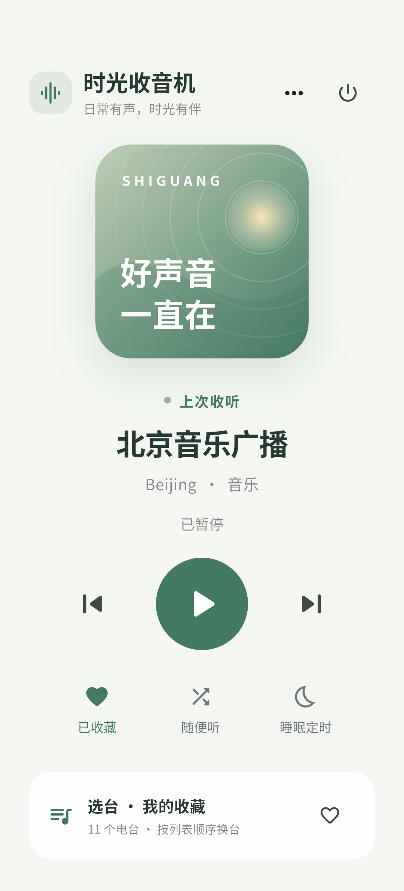
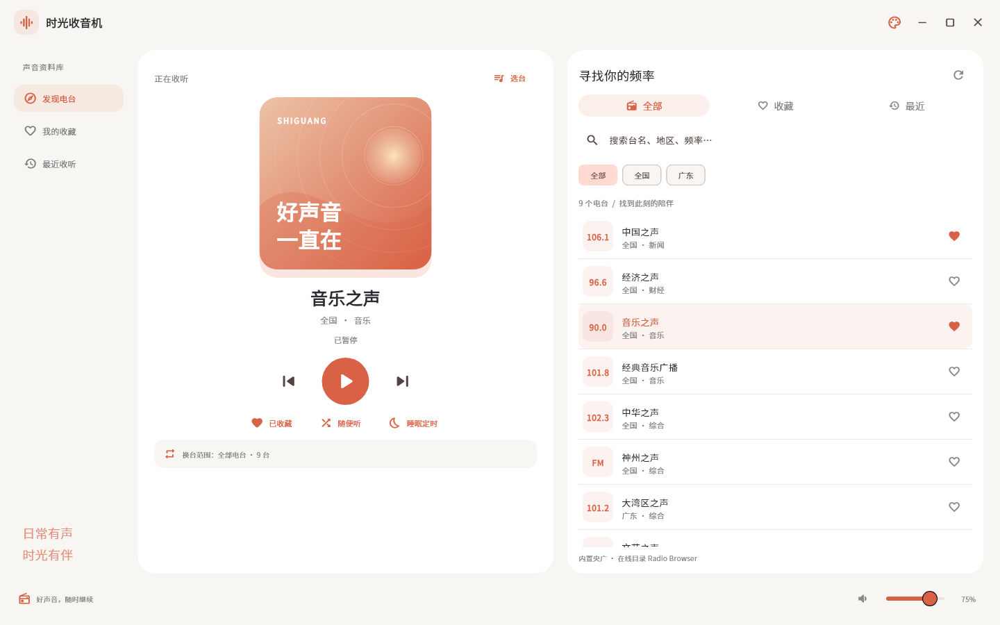
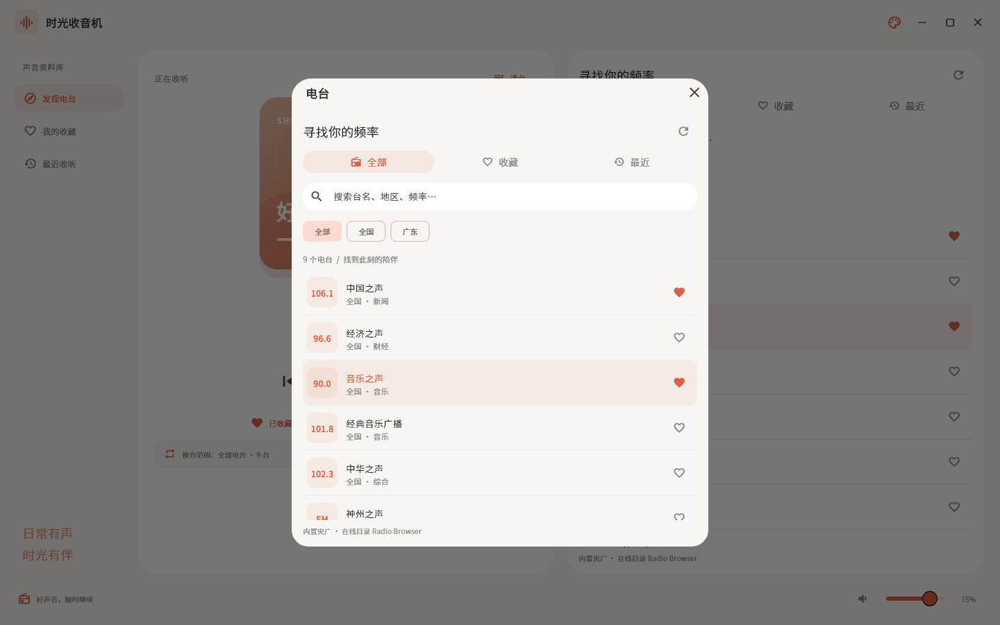

# 时光收音机

Flutter + Dart + Riverpod 国内网络电台，面向 Windows、Android，预留 macOS、iOS 工程。手机和桌面共用现代配色与播放状态，按各自屏幕尺寸布局。

## 运行

```powershell
flutter pub get
flutter run -d windows
flutter devices
flutter run -d <安卓设备ID>
```

本机 Flutter 位于 `C:\Users\mi_du\dev\flutter`，未加入 PATH 时用完整的 `bin\flutter.bat` 路径。本机 JDK 位于 `C:\Users\mi_du\dev\jdk-17`。

Windows 需要 Visual Studio C++ 桌面工具链与插件链接支持。未启用 Windows 开发者模式时，可执行 `scripts/prepare-windows.ps1` 在项目内创建目录联接，不改系统设置。执行 flutter clean 后需要重新准备。

Android 需要 JDK 17+、Android SDK 与 USB 调试设备。首次构建需要下载 Gradle、Maven 和 SDK 组件。

## 功能

- 手机主页：声波封面、圆形播放按钮、收藏/随机/睡眠定时与底部选台面板，无音量滑块；右上角菜单更换暖日珊瑚/晴空蓝/松间绿配色或查看关于，电源按钮退出。
- 桌面使用现代播放卡片，宽窗口并排显示选台、收藏和最近列表，窄/矮窗口收起列表；保留无边框拖动缩放、最小化/最大化/退出与系统工作区适配。
- 内置国内电台；Radio Browser 国内目录手动刷新、多镜像回退、本机缓存。
- 搜索、地区筛选、收藏排序、最近收听、随机台、睡眠定时；手机使用系统音量键，桌面保存应用音量。
- 记住上次电台及有序换台列表，重新打开恢复展示；从收藏选台后重启，上一台/下一台仍在同一收藏范围内切换。
- 原创收音机应用图标；Android 12+ 原生启动屏的背景与 Logo 跟随保存的配色。资源和重新生成方法见 [图标说明](assets/branding/README.md)。
- 原生音频缓冲、断流检测、指数退避重连、网络恢复后自动续播；主动暂停取消重连。
- Android 后台音频、通知栏、锁屏、标准媒体上一台/下一台；Windows 无边框窗口、窗口内媒体键。

上一台/下一台按选台时的可见列表循环：收藏按保存顺序，地区按该地区列表，搜索按结果列表。仅浏览其他列表不会改变播放队列；收藏页拖动右侧手柄可排序并保存。随机播放和系统媒体键共用当前队列。启动不自动出声。

## 缓存与平台边界

目录、收藏、历史、音量、皮肤保存在磁盘。音频采用播放器内存缓冲，不是录音或离线节目。Android 目标缓冲 30–90 秒，Windows 解复用缓存 16 MiB；实际时长受直播协议、服务器窗口和码率限制。断网后缓冲耗尽会等待，联网后回到当前直播点。

目标车联是 **ICCOA CarLink 手机车联**。当前已实现标准 Android MediaSession/MediaBrowserService 控制入口，尚未完成 ICCOA 合作方接入与实车验收，不能保证车机桌面发现应用。具体边界见车机文档。没有集成 HiCar SDK。

Windows 暂无 SMTC 全局媒体集成或托盘。macOS/iOS 已生成平台工程与后台/网络配置，必须在 Mac + Xcode 编译和真机验证。

## 学习文档

1. [Dart、Flutter、Riverpod 学习路线](docs/learning-guide.md)
2. [架构与播放恢复](docs/architecture.md)
3. [平台与 ICCOA CarLink](docs/platforms-and-carlink.md)
4. [测试与验收](docs/testing.md)

建议阅读顺序：`models/station.dart` → `data/station_repository.dart` → `audio/` → `providers.dart` → `ui/` → `main.dart`。

```powershell
dart format lib test
flutter analyze
flutter test
flutter build windows --release
flutter build apk --release
```

内置源来自央广公开直播地址，在线目录来自 [Radio Browser](https://www.radio-browser.info/)，节目由各电台/CDN 直接提供；线路可能变化或受地区限制。部分电台需要 HTTP，Android 已允许明文媒体流，没有禁用 TLS 验证。不含账号、广告、追踪或收藏云同步。商业分发前需核实节目授权与签名；Android release 当前仍用模板调试签名。


## 界面预览

手机采用独立现代页面：



桌面现代布局（Flutter Widget 渲染预览）：






## 本机运行包

- `dist/shiguang-radio-windows.zip`：Windows Release，解压整个目录后运行 shiguang_radio.exe。
- `dist/shiguang-radio-windows-modern.zip`：最新现代桌面版；同名目录已解压，直接运行其中 shiguang_radio.exe。旧归档保留供对比。
- `dist/shiguang-radio-android-debug.apk`：Android 调试包，适合本机学习与真机验证，未配置正式发行签名。

最终静态检查通过，16 项逻辑/布局测试通过，4 张主页皮肤/手机渲染及选台弹窗预览已生成。具体未验收项见 docs/testing.md。


Windows 无边框修正版：dist/shiguang-radio-windows-frameless-v2.zip。关闭旧进程后解压到新目录运行，不要只复制 exe。原生裁剪移除圆角外背景，边缘缩放由 Windows 命中测试处理。


Android 主页采用全屏无装饰外框布局；状态栏与导航栏默认隐藏，可通过系统边缘手势临时唤出。最新真机图见 docs/previews/android-borderless.png。

