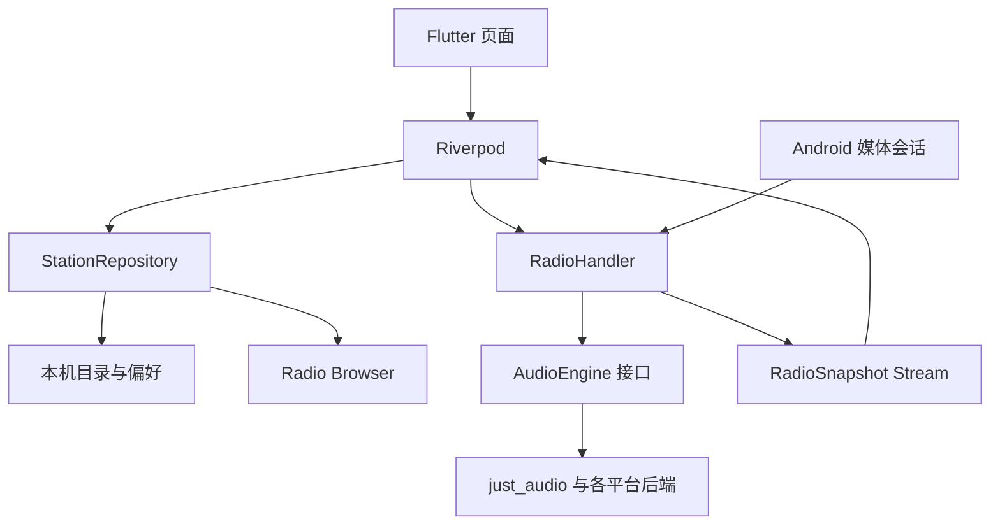

# 架构、缓存与恢复

## 一次选台

1. select 设置电台与 wantPlay=true，取消旧 Timer，递增 generation；先保存电台及有序播放列表，再连接网络。
2. 停止旧流，连接新 URL。
3. 成功后播放、更新快照与系统媒体元数据。
4. 失败则退避重试，并轮换候选线路。

generation 是请求标记。旧请求返回时，只有标记仍匹配且 wantPlay=true 才能启动播放；暂停也递增标记，防止旧连接在暂停之后突然出声。

## 状态机

| phase | 含义 |
|---|---|
| idle | 尚未选台，不重连 |
| connecting | 连接中，超时后重试 |
| playing | 已准备并请求播放 |
| buffering | 数据不足，等待超过 25 秒重连 |
| retrying | 2/4/8/16/30 秒指数退避，持续重试 |
| paused | 主动暂停或定时停止，不重连 |

wantPlay 单独保存用户意图：断网时没有声音不代表用户想暂停。网络类型变化只加快重试，不证明互联网可用。恢复以实际直播连接结果为准。

暂停停止原生流、释放连接；恢复重新连接当前直播点。睡眠定时调用同一暂停路径。AudioEngine 接口让逻辑测试无需真实声卡。所有入口共用 RadioHandler，避免前台、通知栏与车机各有一份播放状态。

## 三种缓存

| 内容 | 保存位置 | 保留范围 |
|---|---|---|
| 电台目录 | assets + SharedPreferences JSON | 重启、离线浏览 |
| 收藏/历史/皮肤/音量 | SharedPreferences | 重启后保留 |
| 上次电台与换台列表 | SharedPreferences 的 playback.session.v1 JSON | 冷启动恢复电台、列表顺序和范围，保持暂停 |
| 音频 | 原生内存缓冲 | 仅当前播放 |

Android 30–90 秒是加载目标，不扩大 HLS 服务端窗口；Windows 16 MiB 是解复用缓存而非总内存上限；Apple 前向缓冲是 AVPlayer 偏好值。直播无法缓存未来节目，未实现磁盘录音或回听。

缓存损坏回退内置目录；刷新失败保留旧列表。网络请求每镜像超时 12 秒。目录按播放 URL 去重，同名不同线路仍可能存在。刷新由用户主动触发，不阻塞启动。

## 列表范围与收藏排序

RadioHandler 分开保存完整目录与当前播放队列。点击电台时 selectFromList 接收可见电台的不可变副本和列表标题，之后上一台/下一台、随机台、通知栏与媒体按键都使用这个队列；仅改变筛选界面不打断当前播放范围。更新目录按 ID 更新队列里的对象，不重置为全目录。

收藏使用有序 List<String> 保存 ID，兼容原来的 favorites 偏好项。拖动使用 ReorderableListView 的 onReorderItem，newIndex 已是移除旧项后的目标索引。筛选后排序只替换可见项原来占据的位置，隐藏收藏保持位置。重排或移除收藏会同步当前收藏播放队列；移除正在播放的台不突然中断声音，再次换台时使用剩余列表。当前范围为空时换台无操作。新增收藏在重新从收藏列表选台后加入该次播放范围。

LibraryNotifier.reorderFavorites 是持久化入口，filteredStationsProvider 按收藏 ID 顺序生成显示列表；RadioHandler 接管系统媒体队列，不依赖弹窗是否打开。

## 冷启动恢复

`data/playback_session.dart` 把当前 Station、队列 ID 的有序列表、标题、是否为收藏/限定队列写入一个 JSON。写入串行执行，快速连续换台不会让较旧的异步写入覆盖新选择。选台在网络请求前等待保存；目录更新、收藏排序/删除也更新会话；正常退出等待 flushSession 完成。无需等到退出才保存，因此系统回收进程后仍可恢复。

目录加载后，RadioHandler.setStations 只恢复一次：根据 ID 使用当前目录的最新地址，目录暂缺的当前台可使用会话中保存的 Station；已消失的其他队列项跳过。收藏顺序以持久化收藏为准，与原队列取交集，避免扩大此前的筛选范围。损坏 JSON 回退到正常选台流程。恢复不连接音频、不启动重连或睡眠定时；点击播放或上一台/下一台才重新取直播流。

## 手机与桌面呈现

`ui/mobile_radio_player.dart` 是 Android/iOS 页面，使用 RadioSans 内置开源字体；`ui/radio_theme.dart` 的 RadioPalette / radioTheme 为手机和桌面提供统一的现代三色主题，跟随 skinProvider 持久化。手机顶部按 max(48, viewPadding.top + 18) 预留挖孔安全区，顶栏固定，背景铺满屏幕，短屏/大字下播放内容可滚动。手机移除应用音量控件，引擎音量设为 1，实际响度由系统音量键控制。

`ui/desktop_radio_player.dart` 在宽度至少 900、高度至少 560 的窗口中并排显示播放器和 StationLibrary；更宽的窗口增加资料库侧栏。矮窗口横向排列封面与台名，窄窗口通过选台弹窗访问列表，保留底部音量控制。整个窗口客户区填满现代背景，不再用 FittedBox 缩放复古机身；原生 HWND 裁剪跟随整窗圆角与边界。两个视觉层都只发送 handler 命令，保持通知栏和车机媒体入口一致。

`ui/radio_page.dart` 负责页面协调、公共选台弹窗、定时、关于和退出；`ui/station_library.dart` 复用搜索、地区筛选、收藏拖动和选台行为，embedded=true 时列表占满桌面剩余高度。iOS 此次只做 Widget 布局测试，尚未在 Apple 设备编译运行。

## 启动画面配色

Android 系统启动屏出现早于 Dart。只在 Flutter 中换背景无法改变它。SkinNotifier 保存用户选择后经 `platform/startup_appearance.dart` 通知 MainActivity，原生保存独立的 radio_launch 偏好，并在 API 31+ 调用 SplashScreen.setSplashScreenTheme，持久化稳定的 LaunchCoral/LaunchBlue/LaunchGreen 主题名，供下次冷启动在进程建立之前使用。主题同时包含对应的浅色背景和同色系图标。

Android Activity 创建时也读取保存值，窗口底色与 Flutter 首帧一致；main 初始化会再同步一次以迁移旧偏好。Windows 先读取偏好并创建首帧，原生窗口在首帧后显示，因此直接显示选定配色。API 30 及以下的 Activity 启动背景会切换，但系统进程创建前的静态预览仍有平台限制；iOS LaunchScreen 当前仍是静态资源。参考 [Android 原生启动主题持久化](https://developer.android.com/reference/android/window/SplashScreen#setSplashScreenTheme(int))。
